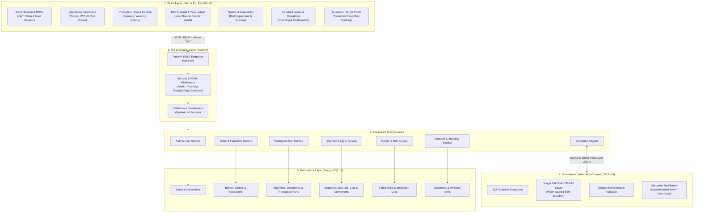
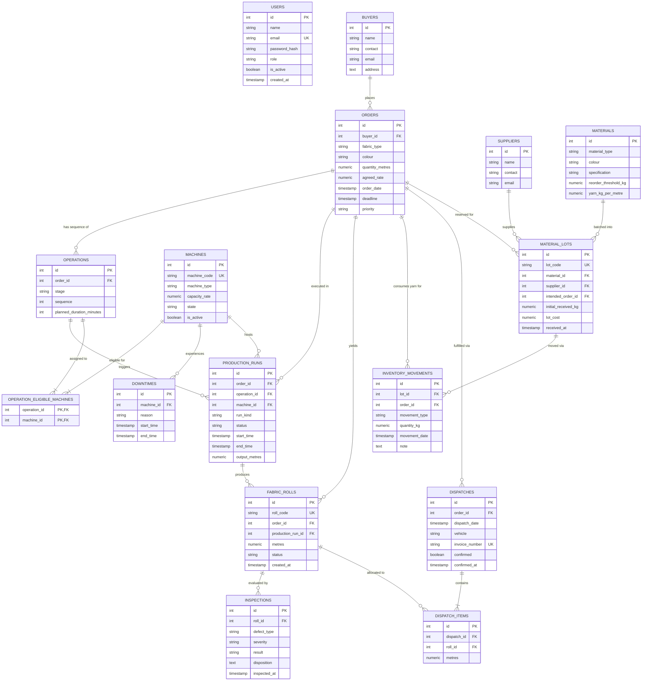

# Textile Manufacturing Intelligence Platform

Unified platform for textile manufacturing operations, replacing manual floor records with real-time operational traceability and constraint-based scheduling. Built for the reference scenario **Everest Textile Mills**.

---

## 🏛️ System Architecture



---

## 🗄️ Database Schema Diagram (ERD)

The PostgreSQL relational database is structured with strict foreign key integrity, check constraints, and indexed lookups.



---

## 📊 Database Entities & Data Dictionary

| Entity | Primary Key | Key Foreign Keys | Purpose & Constraints |
|---|---|---|---|
| `users` | `id` | — | Authenticated users; roles: `admin`, `production_manager`, `dispatch_manager`, `customer`. |
| `buyers` | `id` | — | Customer profiles, commercial contracts, and contact channels. |
| `orders` | `id` | `buyer_id` → `buyers` | Production orders with quantities, deadlines, priorities, and agreed fabric specs. |
| `operations` | `id` | `order_id` → `orders` | Route steps (`spinning` → `weaving` → `dyeing` → `inspection` → `packing` → `dispatch`). |
| `machines` | `id` | — | Production machinery with capacity rates and state (`idle`, `running`, `breakdown`). |
| `operation_eligible_machines` | `(op_id, mach_id)` | `operations`, `machines` | Association matrix mapping which machines are capable of running each operation. |
| `downtimes` | `id` | `machine_id` → `machines` | Breakdown and planned maintenance windows with start and end times. |
| `production_runs` | `id` | `orders`, `operations`, `machines` | Scheduled and actual execution runs with start/end timestamps and output metres. |
| `suppliers` | `id` | — | Raw material yarn and chemical vendors. |
| `materials` | `id` | — | Material catalog with yarn consumption factor (`yarn_kg_per_metre`) and reorder thresholds. |
| `material_lots` | `id` | `materials`, `suppliers`, `orders` | Batch lots with receipt weights, cost, and optional order reservation. |
| `inventory_movements` | `id` | `material_lots`, `orders` | Immutable double-entry material ledger (`receipt`, `issue`, `adjustment`). |
| `fabric_rolls` | `id` | `orders`, `production_runs` | Individual produced rolls tracked by unique QR/code with inspection status. |
| `inspections` | `id` | `fabric_rolls` | Roll inspection slips with defect type, severity, and verdict (`pass`, `rework`, `reject`). |
| `dispatches` | `id` | `orders` | Outbound shipments with vehicle details, invoice number, and confirmation lock. |
| `dispatch_items` | `id` | `dispatches`, `fabric_rolls` | Specific passed rolls included in a shipment manifest. |

---

## ⚙️ Scheduler Engine

- **Route:** `spinning` ➔ `weaving` ➔ `dyeing`.
- **Inputs:** Open orders (deadlines, priorities), processing rates (metres/rate), machine eligibility, maintenance windows, yarn-ready availability.
- **Constraints:**
  1. Exactly one machine per scheduled operation.
  2. Strict stage route order per order.
  3. No machine overlapping operations.
  4. No scheduling during machine downtime.
  5. Cannot begin before yarn-ready time.
- **Solvers:**
  - **Baseline:** Earliest-Deadline-First (EDF) dispatch heuristic.
  - **Optimised:** Google OR-Tools CP-SAT with warm-start from baseline.
- **Disruption Simulation & Re-Planning:** Supports live machine breakdown injection and yarn delivery delay shifts with frozen op preservation.

---

## 🚀 Getting Started

### Prerequisites
- Python 3.11+
- Node.js 18+
- PostgreSQL 14+ (or Docker)

### 1. Database Setup
```bash
docker compose up -d db
```

### 2. Backend Setup
```powershell
cd backend
python -m venv .venv
.\.venv\Scripts\Activate.ps1
pip install -r requirements.txt
cp .env.example .env

# Run database migrations
alembic upgrade head

# Seed synthetic demo data
python -m scripts.seed_users

# Start FastAPI server
.\.venv\Scripts\python.exe -m uvicorn app.main:app --reload --port 8000
```
Interactive Swagger API documentation: `http://localhost:8000/docs`

### 3. Frontend Setup
```powershell
cd frontend
npm install
npm run dev
```
Open application: `http://localhost:3000`

---

## 🧪 Testing

```powershell
# Run backend test suite (FastAPI, business rules, scheduler adapter)
cd backend
.\.venv\Scripts\python.exe -m pytest

# Run scheduler optimization benchmarks
cd scheduler
python -m pytest
```

---

*All operational data across this platform is synthetic and created for evaluation purposes.*